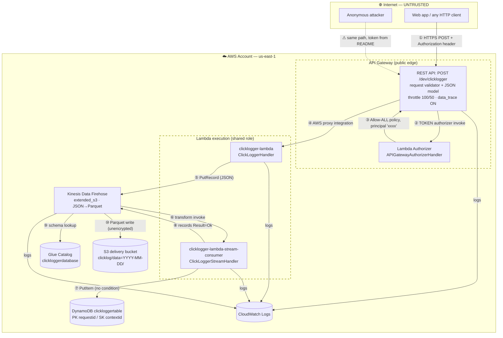

# Threat Model — Ingesting Web Application Click Logs into AWS

| | |
|---|---|
| **System** | `aws-ingesting-click-logs-using-terraform` |
| **Scope** | The API Gateway → Lambda → Kinesis Data Firehose → S3/Glue → Lambda → DynamoDB ingestion pipeline, its Terraform IaC, and the build/deploy process |
| **Methodology** | STRIDE per element, over a Data Flow Diagram with explicit trust boundaries |
| **Version / Date** | 1.0 — 2026-09-14 |
| **Reviewed commit** | `88fb8b6` |
| **Diagram** | [`threat-model.drawio`](./threat-model.drawio) — 3 pages: data flow & trust boundaries, STRIDE per element, attack chains |

> **Note on intent.** This repository is published as a reference architecture / blog sample. Several findings below are acceptable trade-offs for a demo but are **not** acceptable for production. Each finding is tagged accordingly so the model can be used as a production readiness gate rather than a criticism of the sample.

---

## 1. System Overview

A public REST endpoint accepts JSON click/interaction events from web applications. Requests are authorized by a Lambda Authorizer against a static token, processed by an ingestion Lambda that writes to a Firehose delivery stream, transformed in-flight by a consumer Lambda that also writes to DynamoDB, and finally landed in S3 as Snappy-compressed Parquet using a Glue catalog schema.

### 1.1 Assets

| ID | Asset | Why it matters |
|---|---|---|
| A1 | Click-log event records (`user`, `clientip`, `callerid`, `contextid`, behavioural data) | Behavioural PII; subject to GDPR/CCPA; feeds reporting and recommendations |
| A2 | Static authorization tokens (`AUTH_TOKENS`) | Sole gate on the public ingest endpoint |
| A3 | S3 delivery bucket + Parquet objects | System of record for analytics |
| A4 | DynamoDB `clickloggertable` | Low-latency query store, GSI-indexed |
| A5 | IAM roles & policies | Privilege boundary for the whole pipeline |
| A6 | Terraform state (`terraform.tfstate`) | Contains secrets and full resource definitions |
| A7 | CloudWatch Logs | Contains request traces and, currently, secrets |
| A8 | AWS account budget / service quotas | Attacker-drivable cost and availability |
| A9 | Glue Data Catalog schema | Controls how landed data is interpreted by Athena/consumers |

### 1.2 Actors

| Actor | Trust level | Notes |
|---|---|---|
| Legitimate web app (ORDERAPP, BILLAPP) | Semi-trusted | Holds a shared token; token is embeddable in browser-side code |
| Anonymous internet user | Untrusted | Can reach the API endpoint; token is published in `README.md` |
| Analytics consumer (Athena, BI) | Trusted | Reads S3/Glue/DynamoDB |
| Operator / deployer | Privileged | Runs `terraform apply` with account-level credentials |
| AWS platform services | Trusted | Firehose, Glue, Lambda, CloudWatch |

---

## 2. Data Flow Diagram

### 2.1 Trust Boundaries

| # | Boundary | Crossing flows | Controls present today |
|---|---|---|---|
| **TB-1** | Internet → API Gateway | ① | TLS, static-token authorizer, JSON schema validator, stage throttling |
| **TB-2** | API Gateway → Authorizer → Integration | ②③④ | IAM invocation role; **authorizer returns allow-all** |
| **TB-3** | API Gateway → Ingestion Lambda | ④ | `aws_lambda_permission` scoped to the REST API execution ARN |
| **TB-4** | Lambda → Firehose (service boundary) | ⑤ | IAM `firehose:*` on the stream ARN |
| **TB-5** | Firehose → Transform Lambda → DynamoDB | ⑥⑦ | Shared Lambda role; **no conditional write** |
| **TB-6** | Firehose → S3 / Glue (data at rest) | ⑨⑩ | **`s3:*` / `glue:*` on `Resource: "*"`**; no bucket encryption or policy |
| **TB-7** | Operator workstation → AWS (IaC) | `terraform apply` | Local state, no backend encryption, secrets in plaintext |
| **TB-8** | All components → CloudWatch Logs | logs | Retention 3–7 days; **secrets and payloads written in clear** |

---

## 3. Threat Register

Risk = Likelihood × Impact. **P** = production blocker, **D** = acceptable for the demo as published.

### 3.1 Spoofing (S)

| ID | Threat | Evidence | Risk | Tag |
|---|---|---|---|---|
| **S-1** | **Universal shared secret authenticates every caller.** `AUTH_TOKENS = "ALLOW=ORDERAPP;ALLOW=BILLAPP;"` is a static bearer token with no expiry, rotation, binding, or per-request signature. Anyone possessing the string is indistinguishable from the real application. | `terraform/templates/lambda.tf` (`AUTH_TOKENS` env var); `APIGatewayAuthorizerHandler.java:20-24` | **Critical** | P |
| **S-2** | **The token is published in the repository.** `README.md` §Test instructs callers to send `Authorization: ALLOW=ORDERAPP`. Any reader of the public repo can authenticate to any deployment of this stack that kept the defaults. | `README.md` "Add Header: Key 'Authorization' with value 'ALLOW=ORDERAPP'" | **Critical** | P |
| **S-3** | **Token is browser-embeddable.** The intended client is a web page; a static header value in front-end JavaScript is readable by every visitor via DevTools. There is no origin binding — `Access-Control-Allow-Origin: '*'` — so any site can replay it. | `apigateway.tf` integration response headers | **High** | P |
| **S-4** | **Caller identity is self-asserted.** `callerid`, `user`, and `clientip` are taken verbatim from the request body. An attacker chooses which application and which end user their events are attributed to. `clientip` is never populated from `$context.identity.sourceIp`. | `ClickLoggerHandler.java` (defaults only when blank); `glue.tf` `clientip` column | **High** | P |
| **S-5** | **Authorizer principal is a constant.** `String principalId = "xxxx"` for every caller, so API Gateway access logs and `$context.authorizer.principalId` cannot distinguish tenants. | `APIGatewayAuthorizerHandler.java:25` | **Medium** | P |

### 3.2 Tampering (T)

| ID | Threat | Evidence | Risk | Tag |
|---|---|---|---|---|
| **T-1** | **Unconditional overwrite of existing records.** `putItem` with attacker-chosen `requestid` (PK) and `contextid` (SK) and no `ConditionExpression` lets a caller silently replace any previously recorded event whose key they can guess or observe. | `ClickLoggerStreamHandler.java` `updateClickData` | **High** | P |
| **T-2** | **Analytics data poisoning.** No rate limit per caller, no schema constraints beyond "is a string", and no server-side provenance. A flood of fabricated events corrupts the reports and recommendations the README names as the system's purpose. | `apigateway.tf` model has no `maxLength`/`pattern`; stage throttle is global | **High** | P |
| **T-3** | **Cross-bucket write via over-broad Firehose role.** The delivery role holds `"s3:*"`, `"glue:*"`, `"logs:*"`, `"lambda:*"` on `"Resource": "*"`. Compromise of Firehose configuration or of the transform Lambda (which shares the account) enables read/write/delete of *every* S3 bucket and mutation of *every* Glue table in the account. | `roles.tf` `click_logger_stream_consumer_firehose_inline_policy` | **Critical** | P |
| **T-4** | **Invalid records are still landed.** The transform Lambda marks every record `Result.Ok` even when `valid_input == false`; only the DynamoDB write is skipped. Malformed events therefore reach S3/Parquet while being absent from DynamoDB, permanently desynchronising the two stores. | `ClickLoggerStreamHandler.java` — `record.setResult(Ok)` outside the `if(valid_input)` guard | **High** | P |
| **T-5** | **Silent record drop on malformed JSON.** `JsonSyntaxException` is caught, printed, and the record is never added to the response list. Firehose requires a response entry per input record; the missing `recordId` causes the whole batch to be treated as failed/dropped — an attacker can destroy legitimate co-batched records by injecting one malformed payload. | `ClickLoggerStreamHandler.java` catch block | **High** | P |
| **T-6** | **Log injection.** Field values are concatenated straight into `logger.log(...)` and `System.out.println(...)`. Embedded CRLF and forged JSON fragments let an attacker fabricate log lines, breaking log-based detection and any downstream log parser. | `ClickLoggerHandler.java` / `ClickLoggerStreamHandler.java` `req` string construction | **Medium** | P |
| **T-7** | **Downstream formula injection.** Values beginning `=`, `+`, `-`, `@` land unescaped in Parquet and will execute if the analytics output is exported to a spreadsheet. | No output encoding anywhere in the pipeline | **Medium** | P |
| **T-8** | **Mutable transform code reference.** Firehose pins the processor to `...:$LATEST`. Any principal able to `UpdateFunctionCode` silently changes in-flight data transformation with no version audit trail. | `firehose.tf` `parameter_value = "${...arn}:$LATEST"` | **Medium** | P |
| **T-9** | **Glue table location is an ARN, not an S3 URI.** `location = aws_s3_bucket...arn` yields `arn:aws:s3:::bucket` instead of `s3://bucket/`. The catalog therefore does not describe the real data location — a correctness defect that also undermines any control keyed on catalog location. | `glue.tf` `storage_descriptor.location` | **Medium** | P |
| **T-10** | **Catalog/serde mismatch.** The Glue table declares `classification = "json"` with `JsonSerDe` while Firehose writes Parquet/Snappy. Consumers reading via the catalog get wrong or unreadable results. | `glue.tf` vs `firehose.tf` `parquet_ser_de` | **Low** | P |

### 3.3 Repudiation (R)

| ID | Threat | Evidence | Risk | Tag |
|---|---|---|---|---|
| **R-1** | **No attributable identity in any record.** Combining S-1, S-4 and S-5, nothing in the stored event ties it to a verified caller. No event can be proven genuine, and no fraudulent event can be attributed. | whole auth path | **High** | P |
| **R-2** | **Log retention is 3–7 days.** Lambda groups: 3 days; API Gateway group: 7 days. Below the window in which most incidents are discovered, and below common audit requirements. | `cloudwatch.tf`, `apigateway.tf` | **Medium** | P |
| **R-3** | **No API Gateway access logging.** Only execution logging is enabled. There is no structured per-request record of source IP, latency, status, or authorizer outcome. | `apigateway.tf` `aws_api_gateway_method_settings` has no `access_log_settings` | **Medium** | P |
| **R-4** | **No CloudTrail / data-event auditing declared.** The stack provisions no trail, so S3 and DynamoDB data-plane access is unaudited. | absent from IaC | **Medium** | D |
| **R-5** | **Client-supplied timestamps.** `createdtime` is only defaulted when blank, so callers can backdate or postdate events. The default format string in the stream handler is also wrong — `"mm-dd-yyyy hh:mm:ss"` uses minutes where months are intended. | `ClickLoggerStreamHandler.java` `SimpleDateFormat("mm-dd-yyyy hh:mm:ss")` | **Medium** | P |

### 3.4 Information Disclosure (I)

| ID | Threat | Evidence | Risk | Tag |
|---|---|---|---|---|
| **I-1** | **Authorization token written to CloudWatch Logs.** `System.out.println("received token - " + token)` persists the shared secret in plaintext for every request. Anyone with `logs:GetLogEvents` — a permission the API Gateway role holds on `Resource: "*"` — harvests the credential. | `APIGatewayAuthorizerHandler.java:19` | **Critical** | P |
| **I-2** | **Full request/response payload logging.** `data_trace_enabled = true` writes complete bodies and headers to CloudWatch, placing behavioural PII (A1) into a second, less-governed datastore. AWS explicitly recommends against this outside debugging. | `apigateway.tf` `settings.data_trace_enabled` | **High** | P |
| **I-3** | **S3 bucket has no encryption, no public access block, no TLS-only policy, no access logging, no versioning.** The `aws_s3_bucket` resource is declared with only `bucket` and `tags`. While S3 now applies SSE-S3 by default account-wide, nothing in this IaC asserts it, and nothing blocks a subsequent public ACL or an unencrypted-transport read. | `s3.tf` (entire file) | **High** | P |
| **I-4** | **DynamoDB uses the default AWS-owned key with no explicit `server_side_encryption` block, no PITR, no deletion protection.** PII at rest with no customer-controlled key and no recovery path. | `dynamodb.tf` | **High** | P |
| **I-5** | **Firehose delivery is unencrypted and uncompressed.** `compression_format = "UNCOMPRESSED"` and no `kms_key_arn` on the extended S3 configuration. | `firehose.tf` | **Medium** | P |
| **I-6** | **Secrets in Terraform state and outputs.** `AUTH_TOKENS` is an inline literal, so it is stored in plaintext in `terraform.tfstate`. `output "lambda-clicklogger"` and `output "lambda-clicklogger-authorzer"` emit the **entire function resource object** — including the environment block — to console and state, with no `sensitive = true`. No remote backend with encryption is configured. | `lambda.tf` outputs; no `backend` block in `providers.tf` | **Critical** | P |
| **I-7** | **`Access-Control-Allow-Origin: '*'` with `Allow-Methods: '*'`.** Any origin may invoke the endpoint from a victim's browser, and permissive `Allow-Headers` includes `Authorization`. | `apigateway.tf` `MyDemoIntegrationResponse` | **High** | P |
| **I-8** | **Behavioural PII with no lifecycle.** `user` and `clientip` are stored indefinitely — no S3 lifecycle rule, no DynamoDB TTL, no deletion or export path. GDPR Art. 17 (erasure) and Art. 15 (access) cannot be satisfied. | `s3.tf`, `dynamodb.tf` | **High** | P |
| **I-9** | **GSI projects PII broadly.** `ContextCallerIndex` projects `clientip` and the rest of the record, widening the surface any read grant exposes. | `dynamodb.tf` `non_key_attributes` | **Low** | D |
| **I-10** | **Error masking hides failures rather than protecting data.** `fail_response = "200 OK"`, the bad-request path returns HTTP 200, and `updateClickLogRequestToStream` swallows every exception and returns `false` which is discarded — so the handler answers `200 OK` even when the Firehose write failed. Clients cannot detect data loss. | `ClickLoggerHandler.java` | **High** | P |

### 3.5 Denial of Service (D)

| ID | Threat | Evidence | Risk | Tag |
|---|---|---|---|---|
| **D-1** | **Account-wide Lambda concurrency exhaustion.** No `reserved_concurrent_executions` on any function. A flood at the endpoint consumes the region's unreserved concurrency pool and starves every other Lambda in the account. | `lambda.tf` | **High** | P |
| **D-2** | **Cost amplification.** Each function is provisioned at **2048 MB / 300 s** for work that needs a fraction of that. Combined with a 100 rps stage throttle and a published token (S-2), sustained abuse is a direct and substantial billing attack — amplified again by Firehose ingestion, S3 PUTs, and DynamoDB write capacity. | `lambda.tf` `memory_size`, `timeout` | **High** | P |
| **D-3** | **DynamoDB provisioned-throughput exhaustion.** Base table and GSI are fixed at 5 RCU / 5 WCU with no auto-scaling and no on-demand mode. A modest burst throttles writes; the transform Lambda has no retry or DLQ, so throttled events are lost. | `dynamodb.tf` | **High** | P |
| **D-4** | **No WAF, no API key, no usage plan, no per-caller quota.** Throttling is a single global stage setting; one abusive caller consumes the budget for all. | `apigateway.tf` | **High** | P |
| **D-5** | **Authorizer NPE on missing configuration.** If `AUTH_TOKENS` is unset, `env_auth_tokens.split(";")` throws `NullPointerException` → 500 on every request. There is no null guard. | `APIGatewayAuthorizerHandler.java:22` | **Medium** | P |
| **D-6** | **Authorizer ARN parsing is unguarded.** `methodArn.split(":")` then `arnPartials[5].split("/")` with direct indexing — a malformed ARN causes `ArrayIndexOutOfBoundsException`. Low likelihood (ARN is service-supplied) but it is an unvalidated parse on a request path. | `APIGatewayAuthorizerHandler.java:29-35` | **Low** | D |
| **D-7** | **No dead-letter queue on either Lambda.** Failed invocations are lost with no replay path. | `lambda.tf` | **Medium** | P |
| **D-8** | **Region-global API Gateway account setting.** `aws_api_gateway_account` sets the CloudWatch role for **every** API in the account/region. `terraform destroy` therefore breaks logging for unrelated APIs — a self-inflicted availability and audit outage. | `apigateway.tf` `click_logger_api_gateway_account` | **Medium** | P |
| **D-9** | **`terraform destroy --auto-approve` in the Makefile `destroy` and `all` targets.** One mistyped target destroys the stack without confirmation. | `terraform/templates/Makefile` | **Medium** | D |

### 3.6 Elevation of Privilege (E)

| ID | Threat | Evidence | Risk | Tag |
|---|---|---|---|---|
| **E-1** | **The authorizer grants an allow-ALL policy on every success.** `AuthPolicy.PolicyDocument.getAllowAllPolicy(...)` resolves to `HttpMethod.ALL` on resource `"*"` — `arn:aws:execute-api:region:acct:apiId/stage/*/*`. Any valid token authorizes **every method on every resource of every current and future route in that stage**, not just `POST /clicklogger`. Adding any new endpoint silently exposes it to all existing token holders. | `APIGatewayAuthorizerHandler.java:38`; `AuthPolicy.java:93-95` | **Critical** | P |
| **E-2** | **Authorizer result caching is unconfigured.** `aws_api_gateway_authorizer` sets no `authorizer_result_ttl_in_seconds`, so API Gateway applies the 300 s default. A token revoked by changing the env var remains accepted — and its allow-all policy remains cached — for up to five minutes. | `apigateway.tf` `clicklogger-authorizer` | **Medium** | P |
| **E-3** | **One IAM role shared by all three Lambdas.** The authorizer, the ingestion handler, and the transform handler all assume `clicklogger-lambda-role`. The authorizer — the component most exposed to untrusted input — therefore holds `dynamodb:PutItem`/`Scan`/`Query` and `firehose:*`, which it has no need for. Least privilege is violated in the highest-risk direction. | `lambda.tf` (all three), `policies.tf` | **High** | P |
| **E-4** | **Wildcard actions in the Lambda policy.** `"firehose:*"` grants `DeleteDeliveryStream` and `UpdateDestination` alongside `PutRecord`; the DynamoDB grant includes `Scan` and `ListTables` that no handler uses. | `policies.tf` `click_loggerlambda_logging_policy` | **High** | P |
| **E-5** | **Logging policy scoped to `arn:aws:logs:*:*:*`.** Every Lambda can write to any log group in any region — enabling log forgery and pollution across the account. | `policies.tf` | **Medium** | P |
| **E-6** | **API Gateway CloudWatch role reads all logs.** The role holds `logs:GetLogEvents` and `logs:FilterLogEvents` on `"Resource": "*"`, so anyone able to assume it reads every log group in the account — which, per **I-1**, includes the authorization token. E-6 and I-1 chain into full credential compromise. | `policies.tf` `click_logger_api_gateway_cloudwatch_policy` | **High** | P |
| **E-7** | **Deprecated Java 8 (Amazon Linux 1) runtime.** `runtime = "java8"` is past end-of-support; it no longer receives security patches and blocks deployment updates. | `lambda.tf` (×3) | **High** | P |
| **E-8** | **Aged dependencies, no SCA.** AWS SDK v1 `1.11.774` (2020) is in maintenance mode; `mockito-core 2.22.0` is from 2018; **`junit 4.13.1` is declared at compile scope**, shipping test code into the Lambda artifact and enlarging its attack surface. No dependency scanning, lockfile, or checksum verification exists. | `pom.xml` | **High** | P |
| **E-9** | **Unpinned Maven wrapper download.** `MavenWrapperDownloader.java` fetches `maven-wrapper.jar` over the network at build time with no checksum validation — a supply-chain injection point in CI. | `.mvn/wrapper/` | **Medium** | P |
| **E-10** | **Non-constant-time token comparison.** `Arrays.asList(split).contains(token)` uses `String.equals`, which short-circuits. Remotely exploiting this across the internet is impractical, but it is the wrong primitive for a secret comparison. | `APIGatewayAuthorizerHandler.java:24` | **Low** | D |
| **E-11** | **Operator runs `terraform apply` with broad account credentials.** No CI/CD role, no plan review gate, no policy-as-code (OPA/Sentinel/tfsec) in the repo. Compromise of a developer workstation is compromise of the account. | `Makefile`, no pipeline config (Azure Pipelines was removed in `88fb8b6`) | **High** | P |

---

## 4. Attack Scenarios

Chains that turn individual findings into realised loss. Drawn on page 3 of `threat-model.drawio`.

### AS-1 — Credential harvest → full stage access *(I-1 + E-6 + E-1)*
An insider or a compromised principal that can assume `clicklogger-api-gateway-cloudwatch-global-role` calls `FilterLogEvents` on `*`, reads `"received token - ALLOW=ORDERAPP"` from the authorizer log group, and replays the token. Because the authorizer returns an allow-all policy, they now hold access to every method and every resource on the stage — including any endpoint added later. **No exploit is required; only a log read.**

### AS-2 — Public token → analytics destruction *(S-2 + T-1 + T-2)*
An attacker reads the token from this public README, observes or guesses `requestid`/`contextid` pairs, and issues `POST /clicklogger` with matching keys. Each write unconditionally overwrites the genuine DynamoDB item. The S3 Parquet history diverges from DynamoDB, and the discrepancy surfaces only when reports disagree.

### AS-3 — Batch-poisoning data loss *(T-5)*
An attacker submits one payload that serialises to malformed JSON at the Firehose boundary. The transform Lambda's `JsonSyntaxException` handler drops that record from the response list entirely. Firehose sees a response whose record set does not match its input set and fails the batch — destroying the legitimate records batched alongside it. Repeating this at intervals yields sustained, low-volume, hard-to-attribute data loss.

### AS-4 — Cost and availability attack *(S-2 + D-1 + D-2 + D-3)*
Sustained traffic at the 100 rps stage ceiling drives three 2048 MB Lambdas, saturates the account's unreserved concurrency (starving unrelated functions), exhausts 5 WCU on DynamoDB (silently dropping writes, since there is no DLQ), and accrues Lambda-GB-second, Firehose ingestion, and S3 PUT charges. Cost is bounded only by the attacker's patience.

### AS-5 — Lateral movement from data plane to account *(T-3)*
Any compromise reaching the Firehose delivery role — a misconfiguration, a confused-deputy path, or an attacker who can write the role's trust relationship — inherits `s3:*` and `glue:*` on `Resource: "*"`. That is read, write, and delete on every bucket in the account, plus schema control over every Glue table. The blast radius of a click-log pipeline becomes the entire account's data estate.

### AS-6 — Cross-origin browser abuse *(I-7 + S-3)*
Because `Access-Control-Allow-Origin` is `*` and the token is embedded in front-end code, any website can script authenticated ingestion calls in a visitor's browser — attributing fabricated events to that visitor's IP and to whichever `callerid` the attacker chooses.

---

## 5. Prioritised Remediation

### P0 — Before any production deployment

1. **Replace the static token entirely.** Use IAM SigV4 authorization (`authorization = "AWS_IAM"`) for service-to-service callers, or a Cognito/OIDC JWT authorizer for user-facing ones. If a token model is unavoidable, move it to Secrets Manager or SSM SecureString, read it at cold start, rotate it automatically, and compare with `MessageDigest.isEqual`.
2. **Stop logging the token.** Delete `System.out.println("received token - " + token)` from `APIGatewayAuthorizerHandler`. Treat the currently deployed token as compromised and rotate it.
3. **Return a least-privilege policy from the authorizer.** Replace `getAllowAllPolicy(...)` with `getAllowOnePolicy(region, acct, apiId, stage, HttpMethod.POST, "clicklogger")`, and set a real `principalId` derived from the verified caller. Set `authorizer_result_ttl_in_seconds` explicitly (0 while iterating; a short, deliberate value in production).
4. **Scope the Firehose role.** Replace `glue:*`/`s3:*`/`logs:*`/`lambda:*` on `"*"` with the specific actions on the specific bucket ARN (`.../clicklog/*`), the specific Glue database and table, the specific log group, and the specific transform function.
5. **Split the Lambda roles.** Give the authorizer a role with logging only. Give the ingestion Lambda `firehose:PutRecord` + `PutRecordBatch` on the stream ARN. Give the transform Lambda `dynamodb:PutItem` on the table ARN. Drop `Scan`, `ListTables`, and every wildcard.
6. **Remove secrets from state and outputs.** Delete the two whole-resource `output` blocks in `lambda.tf` (or narrow them to ARNs and mark `sensitive = true`), and configure an encrypted, versioned, locked remote backend (S3 + DynamoDB or Terraform Cloud).
7. **Disable `data_trace_enabled`.** Set it to `false` and enable structured **access** logging instead, with an explicit `$context` format that excludes the `Authorization` header.

### P1 — Data protection and correctness

8. **Harden S3** — add `aws_s3_bucket_server_side_encryption_configuration` (SSE-KMS with a CMK), `aws_s3_bucket_public_access_block` (all four flags true), `aws_s3_bucket_versioning`, `aws_s3_bucket_logging`, a lifecycle rule matching your retention policy, and a bucket policy denying `aws:SecureTransport = false`.
9. **Harden DynamoDB** — explicit `server_side_encryption { enabled = true, kms_key_arn = ... }`, `point_in_time_recovery`, `deletion_protection_enabled`, and a TTL attribute so PII expires on schedule.
10. **Fix conditional writes** — add `attribute_not_exists(requestid)` (or a version-based condition) to the `PutItemSpec`, and handle `ConditionalCheckFailedException` as a duplicate rather than an overwrite.
11. **Fix the Firehose transform contract** — always return a response record for **every** input record; use `Result.ProcessingFailed` for malformed or invalid payloads instead of `Ok`, and never drop a `recordId`. This closes T-4 and T-5 together.
12. **Derive server-side context** — populate `clientip` from `$context.identity.sourceIp` and `createdtime` from server time; reject rather than accept client-supplied values for both. Fix the `SimpleDateFormat("mm-dd-yyyy...")` month/minute bug.
13. **Return honest status codes** — propagate the `updateClickLogRequestToStream` boolean; return 4xx on validation failure and 5xx on downstream failure. Sanitise all values before logging (strip CR/LF, cap length).
14. **Tighten input validation** — add `maxLength` and `pattern` to every property in the API Gateway JSON model; the existing `additionalProperties: false` is good and should stay.
15. **Constrain CORS** — replace `'*'` with an explicit origin allowlist and list only the methods and headers actually used.

### P2 — Resilience, cost, and supply chain

16. **Migrate off `java8`** to `java21`, and upgrade to AWS SDK for Java v2.
17. **Move `junit` to `<scope>test</scope>`**, add dependency scanning (OWASP Dependency-Check or Snyk) to CI, and pin/verify the Maven wrapper JAR by checksum.
18. **Add capacity controls** — `reserved_concurrent_executions` on each Lambda, right-size memory/timeout from measured p99, DynamoDB on-demand billing or auto-scaling, and a DLQ (or `destination_config.on_failure`) plus Firehose S3 backup for failed records.
19. **Add per-caller usage plans and API keys**, and front the API with AWS WAF (rate-based rule + managed rule groups).
20. **Add detection** — CloudTrail with S3 and DynamoDB data events, GuardDuty, a billing alarm, and CloudWatch alarms on 4XX/5XX rate, authorizer failures, Firehose `DeliveryToS3.DataFreshness`, and DynamoDB throttles. Raise log retention to ≥90 days (or your audit requirement).
21. **Pin the Firehose processor to a published Lambda version/alias** instead of `$LATEST`.
22. **Fix the Glue catalog** — `location = "s3://${bucket}/clicklog/"`, and set the serde/classification to Parquet to match what Firehose actually writes.
23. **Scope `aws_api_gateway_account` deliberately** — manage this region-global resource in a separate account-bootstrap stack so `terraform destroy` on this project cannot break logging for unrelated APIs.
24. **Add policy-as-code to CI** — `tfsec`/`checkov`/`terraform-compliance` gating `terraform plan`, and deploy via a dedicated CI role rather than developer credentials.

---

## 6. Assumptions and Out of Scope

**Assumptions**
- The stack is deployed into a single AWS account in `us-east-1` as written in `providers.tf`.
- AWS-managed services (Lambda isolation, Firehose durability, S3 durability, KMS) behave per their published security model.
- TLS is terminated by API Gateway with an AWS-managed certificate; no custom domain is configured in this IaC.
- No VPC is used; all Lambdas run outside a customer VPC.

**Out of scope**
- Security of the calling web applications themselves (XSS, CSRF, session handling on the client side).
- Athena/BI consumers reading from S3 and DynamoDB downstream of ingestion.
- AWS account-level guardrails (SCPs, Control Tower, IAM Identity Center) assumed to be managed elsewhere.
- Physical and AWS-side operational security.

**Residual risk after P0+P1+P2.** Behavioural PII ingestion remains inherently sensitive; a legal basis for processing, a documented retention schedule, and a data-subject-rights procedure are organisational controls this model cannot supply.

---

## 7. Finding Index

| Severity | Count | IDs |
|---|---|---|
| **Critical** | 6 | S-1, S-2, T-3, I-1, I-6, E-1 |
| **High** | 23 | S-3, S-4, T-1, T-2, T-4, T-5, R-1, I-2, I-3, I-4, I-7, I-8, I-10, D-1, D-2, D-3, D-4, E-3, E-4, E-6, E-7, E-8, E-11 |
| **Medium** | 17 | S-5, T-6, T-7, T-8, T-9, R-2, R-3, R-4, R-5, I-5, D-5, D-7, D-8, D-9, E-2, E-5, E-9 |
| **Low** | 4 | T-10, I-9, D-6, E-10 |
| **Total** | **50** | Spoofing 5 · Tampering 10 · Repudiation 5 · Info Disclosure 10 · DoS 9 · EoP 11 |
